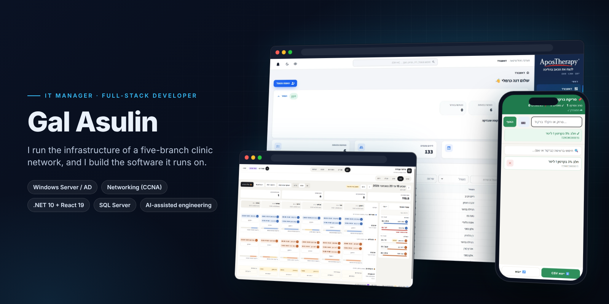

<h1 align="center">Hi, I'm Gal Asulin 👋</h1>

  IT Manager · self-taught full-stack developer · home-lab tinkerer — from Israel 🇮🇱
   
  I run infrastructure, build software end-to-end, and automate everything I can.

  
  

---

### 🇬🇧 About me

- 🖥️ **IT Manager at [AposTherapy](https://www.apostherapy.co.il)** — a physiotherapy clinic network with five branches across Israel. I run the whole stack: networks, Windows Server / Active Directory, domain-joined workstations, remote access (VPN / RDP), the cloud PBX and contact-center telephony, backups, and the hardware inventory across branches.
- 💻 **Full-stack developer (self-taught)** — I designed and built the clinic's own CRM/EMR, in daily use: **.NET 10 (ASP.NET Core) + React 19 / TypeScript**, SQL Server, self-hosted on IIS, with real-time updates, telephony (CTI) integration, SMS / WhatsApp messaging and a CI pipeline.
- 🌐 **Web** — custom WordPress / WooCommerce themes built from scratch: RTL Hebrew, accessibility to IS 5568 / WCAG 2.1 AA, technical SEO and structured data.
- 🤖 **AI-assisted engineering** — I work with AI coding agents under strict rules: no "done" without evidence (a test, a screenshot, a query), a dry-run and an undo path before any data change, and end-to-end checks in a real browser with Playwright.
- 🧩 I like designing **engines, not screens** — form builders, narrative / rule engines and configurable modules instead of hard-coded pages. If a setting matters, it belongs in the admin UI, not in the code.
- 🏠 **Home lab** — an AI-first smart home on **Home Assistant OS** (Zigbee2MQTT, Frigate, Gemini vision, a Telegram bot), documented in [smart-home-showcase](https://github.com/galasulin/smart-home-showcase).
- 🌱 Currently going deeper on: **.NET, React/TypeScript & cloud/system design**.

<h3 dir="rtl" align="right">בקצרה 🇮🇱</h3>

מנהל IT ב-AposTherapy, רשת מכוני פיזיותרפיה עם חמישה סניפים: רשתות, Windows Server/AD, גישה מרחוק, מרכזייה בענן ומוקד טלפוני, גיבויים וציוד בכל הסניפים. במקביל מפתח full-stack בלמידה עצמית — תכננתי ובניתי את מערכת ה-CRM/EMR של המכונים, שנמצאת בשימוש יומיומי (‎.NET 10 + React 19, SQL Server, טלפוניה, SMS ו-WhatsApp). בונה מאפס אתרי WordPress בעברית לפי תקן הנגישות, עובד עם סוכני AI לפיתוח תחת כללי בדיקה קפדניים, ומריץ בבית בית חכם מבוסס AI על Home Assistant OS.

---

### 🏅 Certifications

Professional IT training at John Bryce.

---

### 🛠️ Tech & Tools

**IT & Infrastructure**
-1BA0D7?style=flat&logo=cisco&logoColor=white)

**Backend**

**Frontend & Web**

**Quality & Delivery**

**AI**

**Marketing tech**

**Home automation**

---

### 📌 Featured projects

Every card opens the project. Each repository has a full README in English and Hebrew with screens, architecture and technical parameters.

#### Systems and tools

<table>
<tr><td width="50%" valign="top"> <b><a href="https://github.com/galasulin/clinic-crm">clinic-crm</a></b> · <a href="https://galasulin.github.io/clinic-crm/">Live</a> <b>Clinic CRM / EMR.</b> The system I designed and built for a five-branch clinic network, in production since July 2026: calendar, clinical record, gait lab, leads, sales, landing-page builder, patient portal. .NET 10 · React 19 · SQL Server · SignalR. Trailer, screens and architecture from a demo instance.</td><td width="50%" valign="top"> <b><a href="https://github.com/galasulin/smart-home-showcase">smart-home-showcase</a></b> · <a href="https://galasulin.github.io/smart-home-showcase/">Live</a> <b>AI-first smart home.</b> Home Assistant OS with Gemini vision at the front door, Home Front Command alert choreography, mmWave presence and a Telegram command center.</td></tr>
<tr><td width="50%" valign="top"> <b><a href="https://github.com/galasulin/shift-scheduler-showcase">shift-scheduler-showcase</a></b> · <a href="https://galasulin.github.io/shift-scheduler-showcase/demo/">Live</a> <b>Sidur.</b> A portable, Hebrew-first shift scheduler for multi-branch businesses. Tauri 2 · React · Rust · SQLite. Real app screenshots on demo data and an interactive demo.</td><td width="50%" valign="top"> <b><a href="https://github.com/galasulin/report-analyzer-showcase">report-analyzer-showcase</a></b> · <a href="https://galasulin.github.io/report-analyzer-showcase/?lang=en">Live</a> <b>AI report analyzer.</b> A Windows tool that reads posture and gait device screenshots and writes a finished Hebrew clinical Word report with Claude. Fictional data only.</td></tr>
<tr><td width="50%" valign="top"> <b><a href="https://github.com/galasulin/it-admin-toolkit">it-admin-toolkit</a></b> · <a href="https://galasulin.github.io/it-admin-toolkit/">Live</a> <b>IT admin toolkit.</b> A local Hebrew web UI with 67 admin tools in 11 categories, plus 27 parameterized PowerShell scripts for SQL backups, Microsoft 365, Windows Update and Outlook.</td><td width="50%" valign="top"> <b><a href="https://github.com/galasulin/linkedin-agent-he">linkedin-agent-he</a></b> · <a href="https://galasulin.github.io/linkedin-agent-he/">Live</a> <b>Hebrew LinkedIn agent.</b> A Claude skill that drafts, humanizes and scores Hebrew posts, and publishes through the browser only after I approve the exact text.</td></tr>
</table>

#### Web, e-commerce and a game

<table>
<tr><td width="50%" valign="top"> <b><a href="https://github.com/galasulin/apostherapy-case-study">apostherapy-case-study</a></b> · <a href="https://www.apostherapy.co.il">Live</a> <b>Clinic website.</b> Redesigned and built from scratch as a standalone WordPress theme, RTL Hebrew: Lighthouse SEO 100, built to WCAG 2.1 AA, one lead engine for every form.</td><td width="50%" valign="top"> <b><a href="https://github.com/galasulin/super-asulin-showcase">super-asulin-showcase</a></b> · <a href="https://galasulin.github.io/super-asulin-showcase/">Live</a> <b>Online grocery store.</b> Custom WordPress + WooCommerce: a sell-by-weight engine, one-tap ready baskets and an RTL design system.</td></tr>
<tr><td width="50%" valign="top"> <b><a href="https://github.com/galasulin/supermarket-barcode-scanner">supermarket-barcode-scanner</a></b> <b>Barcode scanner (MIT).</b> A phone scanner used to catalogue that store, with one list shared live across phones.</td><td width="50%" valign="top"> <b><a href="https://github.com/galasulin/galstrike">galstrike</a></b> · <a href="https://galasulin.github.io/galstrike/">Play</a> <b>GalStrike.</b> An open-world 3D web-swinging game in the browser (Three.js / WebGL2), built with Claude Code under my direction. Playable live.</td></tr>
</table>

#### Landing pages

Three static, dependency-free marketing pages for the same product, each built around a different motion technique. All live on GitHub Pages.

<table>
<tr><td width="33%" valign="top"> <b><a href="https://github.com/galasulin/apos4-scroll-landing">apos4-scroll-landing</a></b> · <a href="https://galasulin.github.io/apos4-scroll-landing/">Live</a> <b>Scroll-driven product story.</b> The APOS4 system comes apart and snaps back as you scroll: two canvas frame sequences (56 + 87 transparent WebP frames) scrubbed from scroll progress, progressive frame loading, inertia in a single <code>requestAnimationFrame</code> loop, a reduced-motion end state and an accessible lead form. One HTML file, no framework, no build step.</td><td width="33%" valign="top"> <b><a href="https://github.com/galasulin/apos4-pods-landing">apos4-pods-landing</a></b> · <a href="https://galasulin.github.io/apos4-pods-landing/">Live</a> <b>Pinned-stage pods page.</b> The first take on the same idea: four pod cut-outs from the real product photo move over the sole on a <code>position: sticky</code> stage, driven by scroll progress with CSS transforms, from assembled to apart to a personal calibration.</td><td width="33%" valign="top"> <b><a href="https://github.com/galasulin/apostherapy-research-landing">apostherapy-research-landing</a></b> · <a href="https://galasulin.github.io/apostherapy-research-landing/">Live</a> <b>Research-led page with a 3D hero.</b> A draggable CSS 3D product card with momentum, counters that ease up on entry, staggered scroll reveals, a native <code>&lt;details&gt;</code> FAQ mirrored in <code>FAQPage</code> JSON-LD, and design tokens with light and dark themes.</td></tr>
</table>

**Other**

- **[My-HomeAssistant-Config](https://github.com/galasulin/My-HomeAssistant-Config)** — a fork of [abeksis/My-HomeAssistant-Config](https://github.com/abeksis/My-HomeAssistant-Config) (built on HomeKit Infused), kept in sync as a reference config. Not my own setup — see smart-home-showcase above for that.
